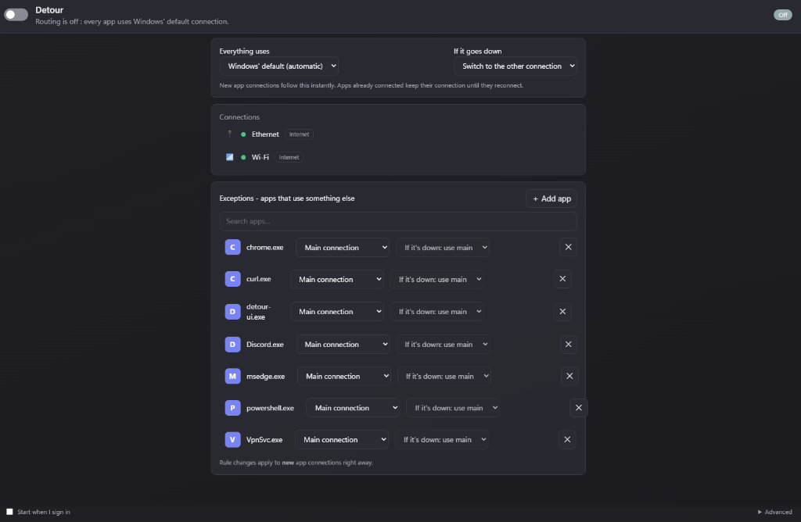
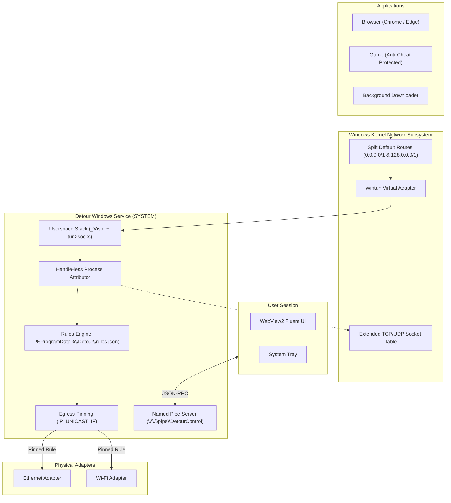

# Detour

> Application-level network connection routing for Windows 11. Bind any application to a specific network interface (Ethernet vs. Wi-Fi) without IP addresses, DLL injection, or LSP hooks.

[](https://github.com/meksenmohammedabderrahmane/detour/actions/workflows/ci.yml)
[](LICENSE)
[-0078D4.svg)](https://www.microsoft.com/windows)

<p align="center">
  
</p>

---

## Why Detour?

Windows 11 automatically routes internet traffic across whichever network interface has the lowest metric. If you have both a fast, capped Ethernet connection and an unmetered Wi-Fi connection, or a stable home connection and a cellular backup, Windows forces all applications onto a single default path.

Existing tools to solve this have major drawbacks:
- **ForceBindIP**: Relies on DLL injection (`WS2_32.dll` hooks) into target processes. This crashes many modern 64-bit applications, triggers anti-cheat bans in online games, and fails on UDP applications that do not bind explicitly.
- **net-merge**: Merges connections into a single local proxy but lacks per-application routing rules, hot-plug recovery, and a native Windows 11 GUI.

**Detour takes a non-invasive, driver-level approach**:
1. Outbound packets are routed into a local [Wintun](https://www.wintun.net) virtual adapter using split-default routes (`0.0.0.0/1` and `128.0.0.0/1`).
2. A userspace TCP/IP stack (Google gVisor + tun2socks) unpacks the flows.
3. The owning application is identified using **handle-less** kernel socket tables.
4. Outbound sockets are pinned directly to the target physical adapter using `IP_UNICAST_IF`.
5. If Detour crashes or terminates, Windows automatically reverts traffic to the physical default route in under 3 seconds.

---

## Measured Performance Numbers

All benchmarks were measured on Windows 11 (23H2):

| Metric | Measured Result | Benchmark Detail |
|---|---|---|
| **UDP Echo Latency Overhead** | **+0.22 ms** (median) | 1,000 UDP echo round trips (engine OFF vs. ON) |
| **Hot-Plug Failover** | **1.33 s** (target <= 5 s) | Link-down detection to alternate connection fallback |
| **Hot-Plug Resumption** | **5.30 s** (target <= 5 s) | Reconnection to designated pinned adapter |
| **Service Crash Recovery** | **2.22 s** (target <= 6 s) | Service killed mid-transfer, SCM auto-restart |
| **STUN Socket Attribution** | **100 / 100** (0 leaks) | 100 fresh UDP sockets verified against public STUN server |
| **UI Idle Footprint** | **368.2 MB** WorkingSet, **0% CPU** | Total sum over complete 7-process WebView2 tree |

---

## Comparison

| Feature | ForceBindIP | net-merge | Detour |
|---|---|---|---|
| **Technology** | DLL injection (`WS2_32.dll`) | Local HTTP/SOCKS proxy | Wintun + userspace gVisor netstack |
| **Anti-Cheat Safe** | No (triggers bans / blocked) | Partial (proxy-based) | **Yes** (zero injection, handle-less) |
| **64-bit App Support** | Fragile (frequent crashes) | Yes | **Yes** (fully transparent) |
| **Early UDP Decision** | No (races socket creation) | No | **Yes** (queued initial datagram, max 250 ms) |
| **Interface Hot-Plug** | No | Requires manual restart | **Yes** (live adapter re-resolution) |
| **Interface Identity** | Hardcoded local IP | Adapter GUID / IP | **Stable GUID + friendly name** |
| **Fallback Policy** | Drop or Windows default | Drop | **Configurable (Fallback or Block)** |
| **Privilege Model** | Per-app launcher | User process | **SYSTEM service + unprivileged UI** |
| **User Interface** | Third-party GUIs | CLI only | **Native Windows 11 Fluent UI + Tray** |

---

## Architecture



---

## Anti-Cheat Safety

Detour was engineered from the ground up for compatibility with online games using modern kernel-level anti-cheat systems (such as Riot Vanguard, Easy Anti-Cheat, and BattlEye):
- **Zero Injection**: Never injects DLLs, hooks code, or alters memory of other processes.
- **Handle-less Attribution**: Resolves process IDs to file paths using `NtQuerySystemInformation(SystemProcessIdInformation)` and kernel IP Helper socket tables without opening open-ended process handles.
- **Early UDP Routing**: Holds initial datagrams up to a 250 ms attribution window, preventing connection leaks onto unintended adapters.
- **Immutable Flows**: Egress binding is fixed during socket creation. Flows never switch adapters mid-game.

Read the full safety specification in [GAME-SAFETY.md](docs/GAME-SAFETY.md).

---

## Limitations

- **Operating System**: Windows 11 (64-bit) only.
- **Privileges**: Administrator rights are required once during setup to install the Windows background service. Once installed, non-admin accounts manage rules through the system tray without UAC prompts.
- **Protocols**: Routes TCP and UDP traffic. ICMP (ping) packets are not routed through application rules due to Windows raw socket API constraints.
- **Anti-Cheat Driver Disclaimers**: While Detour does not touch game memory, kernel anti-cheat engines monitor all active drivers. If a specific game explicitly forbids virtual network adapters (TUN/TAP), running any VPN or virtual interface software could trigger game-specific restrictions.

---

## Quickstart

### 1. Installation
Download the latest `DetourSetup-0.1.0.exe` installer from [Releases](https://github.com/meksenmohammedabderrahmane/detour/releases) and run the installer.

The installer:
- Deploys the engine to `C:\Program Files\Detour`.
- Registers and starts the background Windows Service (`DetourService`).
- Adds the Detour UI to your system tray.

### 2. Basic Configuration

Open Detour from the Start menu or system tray:
1. **Choose Main Connection**: Select your primary internet adapter (e.g. Ethernet). All non-assigned application traffic routes here.
2. **Add an Exception**: Click **Add App**, browse to or enter an executable (e.g. `chrome.exe`), and assign it to another adapter (e.g. `Wi-Fi`).
3. **Pick Down Policy**: Configure whether the app falls back to your main connection or completely blocks traffic if its assigned interface goes offline.

### 3. CLI Management

Detour includes a full CLI client:

```powershell
# Check engine and adapter status
detour status

# Set main connection
detour settings set --main-connection="Ethernet" --main-down-policy=fallback

# Add or modify per-app exceptions
detour rules set curl.exe "Wi-Fi" --down=block

# List active rules
detour rules list

# Toggle engine
detour on
detour off
```

---

## Repository Setup and Customization

To prepare this repository for your own GitHub account:

```powershell
# Replace YOUR_GITHUB_USERNAME with your GitHub username across all documentation
$username = "my-username"
Get-ChildItem -Recurse -File -Include *.md, *.iss, *.yml | ForEach-Object {
    (Get-Content $_.FullName) -replace 'YOUR_GITHUB_USERNAME', $username | Set-Content $_.FullName
}
```

To configure git commits with a privacy-safe GitHub no-reply email:
```powershell
git config user.name "Your Name"
git config user.email "ID+username@users.noreply.github.com"
```

---

## License

This project is licensed under the [MIT License](LICENSE).
Third-party component notices and licenses are documented in [THIRD-PARTY-NOTICES.md](THIRD-PARTY-NOTICES.md).
