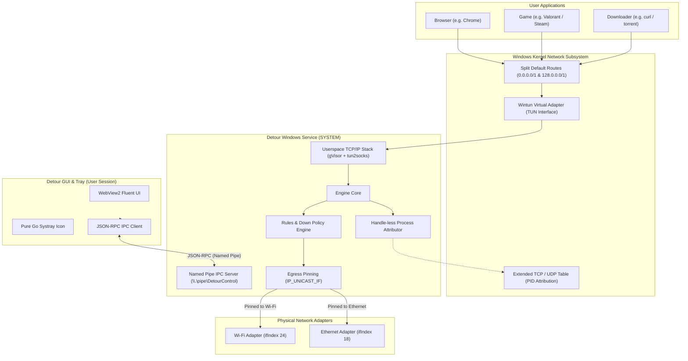

# Detour Architecture and Design

Detour is a per-application network connection router for Windows 11. It allows users to bind specific applications to designated network interfaces (such as Ethernet, Wi-Fi, or LTE cellular connections) without relying on IP addresses, DLL injection, or LSP hooks.

---

## High-Level Architecture

---

## 1. Traffic Capture: Split-Default Routing via Wintun

Windows routing selects the most specific route (longest prefix match) to forward packets. Instead of replacing the existing physical default gateway route (`0.0.0.0/0`), Detour installs two `/1` routes:
- `0.0.0.0/1` (covers `0.0.0.0` through `127.255.255.255`)
- `128.0.0.0/1` (covers `128.0.0.0` through `255.255.255.255`)

Because `/1` is more specific than `/0`, all outbound IPv4 internet traffic from user applications routes into the Wintun virtual adapter. Crucially, the physical default gateway (`0.0.0.0/0`) remains in the routing table. If Detour crashes or stops unexpectedly, Windows immediately falls back to the physical gateway without leaving the user stranded without internet.

---

## 2. Packet Processing: Userspace Stack (gVisor + tun2socks)

Packets arriving on Wintun enter a userspace TCP/IP network stack powered by Google gVisor and tun2socks v2.7.0. The userspace stack terminates incoming TCP handshakes and unpacks UDP datagrams into standard sockets inside the Detour service process.

---

## 3. Game-Safe Attribution: Handle-less Identification

To determine which executable owns a connection without triggering anti-cheat mechanisms:
1. Detour queries the kernel socket ownership tables via `GetExtendedTcpTable` and `GetExtendedUdpTable` using the `TCP_TABLE_OWNER_MODULE_ALL` and `UDP_TABLE_OWNER_MODULE` flags.
2. The resulting process ID (PID) is translated into an image path via `NtQuerySystemInformation` with `SystemProcessIdInformation`.
3. If handle acquisition is ever needed as a fallback, Detour opens the process with `PROCESS_QUERY_LIMITED_INFORMATION` only, inspects image identity, and immediately closes the handle.
4. Detour never acquires handles with `PROCESS_VM_READ`, `PROCESS_VM_WRITE`, or `PROCESS_SUSPEND_RESUME`. Detour never injects DLLs, writes to external memory, or modifies game binaries.

---

## 4. Egress Pinning: IP_UNICAST_IF

Once the application is identified and matched against active rules in `%ProgramData%\Detour\rules.json`:
- For IPv4 sockets, Detour calls `setsockopt` with `IP_UNICAST_IF` and the target interface index (`ifIndex`).
- For IPv6 sockets, Detour calls `setsockopt` with `IPV6_UNICAST_IF`.
- The Windows networking stack then binds all outbound packets of that socket directly to the physical adapter, bypassing the virtual Wintun adapter.

---

## 5. Early UDP Decision and Queueing

Unlike TCP connections (which negotiate a SYN handshake before payload exchange), UDP connections transmit data immediately. To prevent the first datagram of an un-attributed UDP flow from leaking onto the wrong adapter:
- Detour queues the initial datagram for up to 250 ms while the socket table is queried for PID attribution.
- As soon as the PID is attributed, the flow is pinned to its designated adapter and all queued datagrams are released.
- If attribution exceeds 250 ms, the flow proceeds via the configured Main Connection. Once assigned, a flow's adapter is immutable for its lifetime.

---

## 6. IPC and Security Model

Communication between the user UI/CLI and the privileged background service uses a length-prefixed JSON-RPC protocol over a Windows Named Pipe (`\\.\pipe\DetourControl`):
- **DACL**: Restricted to `SYSTEM`, `Builtin\Administrators`, and the specific non-admin user SID captured during installation.
- **Remote Access**: Named pipe flags enforce local access only (`PIPE_REJECT_REMOTE_CLIENTS`).
- **Resilience**: Slow or stalled GUI clients are decoupled through non-blocking event buffers, preventing any dead UI client from impacting packet throughput.
